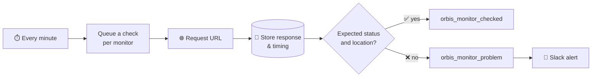

<div align="center">

# 🛰️ Orbis Monitoring

**Know when your websites go down, before your clients do.**

Uptime and response time monitoring built into your [Orbis](https://www.pronamic.eu/orbis/) environment.
Every site you manage, checked every minute, right inside WordPress.

[](https://www.php.net/)
[](https://wordpress.org/)
[](LICENSE)
[](https://actionscheduler.org/)

[Features](#-features) · [How it works](#-how-it-works) · [Installation](#-installation) · [Developers](#-for-developers) · [Contributing](#-development)

</div>

---

## Why Orbis Monitoring?

You already keep your clients, projects and subscriptions in Orbis. Why keep your uptime monitoring in yet another SaaS dashboard?

Orbis Monitoring turns any URL into a **monitor**, a regular WordPress post that lives next to the rest of your work. Every minute it checks whether the site responds the way it should. If something is off, your team hears about it in Slack right away.

No external service. No monthly fee per monitor. Your data stays on your own server.

## ✨ Features

| | |
|---|---|
| ⏱️ **Checked every minute** | Each published monitor is checked every 60 seconds, reliably queued through [Action Scheduler](https://actionscheduler.org/) instead of flaky WP-Cron. |
| 🎯 **More than "is it up?"** | Set the status code you expect (`200`, `301`, `410`, …) and, for redirects, the exact `Location` it should point to. A wrong redirect counts as a problem too. |
| 🔔 **Slack alerts** | Get a message in your channel the moment a monitor fails, with a direct link to the monitor and the response code. |
| 📈 **Response time graphs** | See how fast a site responded over the past year, grouped per day, week or month, with [Chart.js](https://www.chartjs.org/). |
| 🗂️ **Full history** | Every check is stored: duration, status code, message, content type and content length. Spot trends, prove SLAs, find out when it started. |
| 📋 **Overview at a glance** | The admin list shows the last response code, response time, content type and check time of all monitors. |
| 🌐 **Front-end pages** | A `/monitors/` archive and detail pages fit right into the Orbis theme, so your whole team can see the status. |
| 🔌 **REST API ready** | Monitors are available via the WordPress REST API at `/wp-json/wp/v2/orbis/monitors`. |
| 🧩 **Hooks** | Plug in your own notifications, tickets or dashboards with the `orbis_monitor_problem` and `orbis_monitor_checked` actions. |
| 🇳🇱 **Translated** | Ships with Dutch translations, ready for more. |

## 🔄 How it works



1. **Add a monitor**: give it a title and a URL, and optionally the status code and redirect location you expect.
2. **Sit back**: Action Scheduler queues one check per monitor every minute. Checks are unique per monitor, so a slow site never piles up a backlog.
3. **Get notified**: when the response doesn't match, the `orbis_monitor_problem` action fires and your team gets a Slack message.
4. **Dig in**: open the monitor to see its response history and response time graph.

> [!TIP]
> Redirects are **not** followed. That's on purpose: it lets you check that `http://` sends visitors to `https://`, or that an old domain still redirects to the right place.

## 📦 Installation

**Requirements:** WordPress 7.1+, PHP 8.3+ and an [Orbis](https://www.pronamic.eu/orbis/) environment.

1. Download the latest release, or build it yourself (see [Development](#-development)).
2. Upload the `orbis-monitoring` folder to `wp-content/plugins/`.
3. Activate **Orbis Monitoring** in WordPress.
4. Go to **Monitors → Add New** and add your first site. 🎉

### Slack alerts

Install the [Slack](https://wordpress.org/plugins/slack/) plugin and add an integration. Orbis Monitoring adds two events you can choose from:

- **When an Orbis monitor problem was detected**: only the failures, for your alert channel.
- **When an Orbis monitor was checked**: every check, for when you really want to know everything.

## 🧩 For developers

Orbis Monitoring is built to be extended. Hook into the checks to send alerts anywhere you like:

```php
add_action(
	'orbis_monitor_problem',
	function ( WP_Post $post, array|WP_Error $response ): void {
		$url = get_post_meta( $post->ID, '_orbis_monitor_url', true );

		// Create a ticket, send an SMS, page the on-call engineer…
	},
	10,
	2
);
```

| Hook | When | Arguments |
|---|---|---|
| `orbis_monitor_problem` | The response code or `Location` header doesn't match | `$post`, `$response`, `$message` |
| `orbis_monitor_checked` | After every check | `$post`, `$response` |

Want a different look? Add an `archive-orbis_monitor.php` to your theme and it is used instead of the template in this plugin.

## 🧰 Development

```sh
composer install
npm install
```

### Local environment (wp-env)

```sh
npx wp-env start
npx wp-env stop
```

The `.wp-env.json` maps the plugin twice into the WordPress environment:

| Mount path | Source | Purpose |
|---|---|---|
| `wp-content/plugins/orbis-monitoring-dev` | `./` | Live development (including dev files) |
| `wp-content/plugins/orbis-monitoring` | `./build/orbis-monitoring/` | Built distribution version |

Run `composer run build` to create the build version.

### Useful commands

| Command | Description |
|---|---|
| `composer run build` | Build the distribution version and ZIP archive |
| `composer run qa` | Run the code quality checks (PHPCS) |
| `composer run make-pot` | Update the translation catalogs |

### Housekeeping

Monitoring every minute adds up. To keep the database lean, clear old response bodies now and then:

```sql
UPDATE
	orbis_monitor_responses
SET
	response_body = NULL
WHERE
	monitored_date < DATE_ADD( NOW(), INTERVAL -1 MONTH )
;
```

## 📄 License

Orbis Monitoring is free software, licensed under the [GPL-2.0-or-later](LICENSE).

---

<div align="center">

Made with ❤️ by [Pronamic](https://www.pronamic.eu/)

</div>
